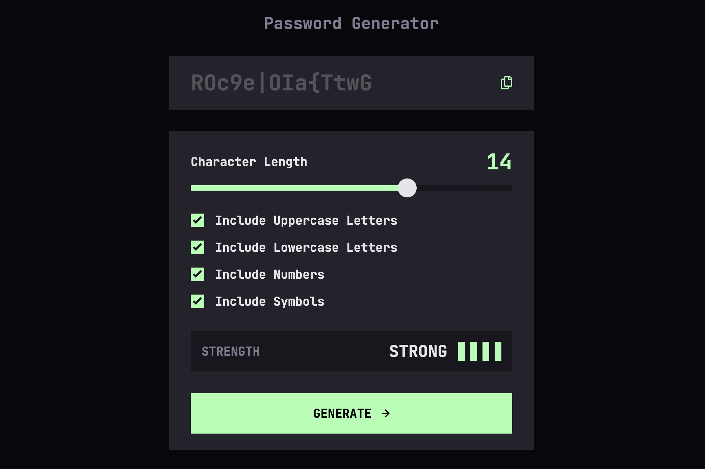

# Password Generator App

A responsive password generator built with React, TypeScript, and Tailwind CSS. This project is a solution to the Password Generator App challenge on Frontend Mentor.

## Tech stack

- React - user inteface
- TypeScript - static type checking
- Vite - development server and build tool
- Tailwind CSS v4 - styling and responsive design
- Zustand - state management
- Web Crypto API - random password generation
- SVGR - SVG icons as React components

## Features

- Generate random passwords with customizable lengths from 1 to 20 characters.
- Choose which character types to include: uppercase letters, lowercase letters, numbers, and symbols.
- View password strength through a four-level, color-coded indicator.
- Copy generated passwords to the clipboard.
- Responsive design for mobile, tablet, and desktop screens.

## What I Learned

- Managing shared application state with Zustand.
- Creating reusable React components with TypeScript.
- Separating password generation and strength calculation into utility functions.
- Generating random values with the Web Crypto API.
- Styling responsive layouts with Tailwind CSS.

## Links

- Live: [Vercel](https://password-generator-app-theta.vercel.app/)
- Code: [GitHub](https://github.com/kirilenko-a/password-generator-app)
- Frontend Mentor Challenge: [Frontend Mentor](https://www.frontendmentor.io/challenges/password-generator-app-Mr8CLycqjh)

## Author

- [GitHub](https://github.com/kirilenko-a)
- [Frontend Mentor](https://www.frontendmentor.io/profile/kirilenko-a)
